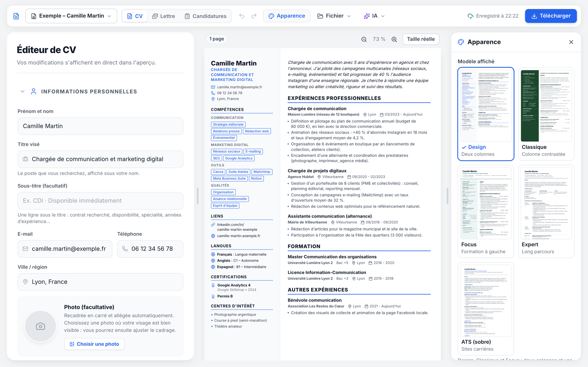

# CV Builder

[](https://github.com/Duorly/CV_BUILDER/actions/workflows/ci.yml)
[](LICENSE)

**Write your CV, tailor a version to each job offer, write the matching cover letter and track your applications,
in the browser, without an account. Your data stays on your computer.**

> 🇫🇷 Un outil pour rédiger son CV, l’adapter à chaque offre, écrire la lettre de motivation et suivre ses
> candidatures, dans le navigateur et sans compte. **[Guide d’utilisation en français](docs/guide-utilisateur.md)**.

The interface is in French; CVs can be produced in French or English.



## Features

- **Live editor and preview**: personal details, profile, skills, experience, education, languages, certifications,
  links, custom sections and free text lines, with drag-and-drop reordering, undo/redo and autosave.
- **Five templates**: *Design*, *Classique* and *Focus* (two columns, colours), *Expert* (one column, dates in the
  margin, for long careers) and *ATS* (one sober column). Thumbnails show your own CV in each one.
- **Appearance settings**: 16 bundled fonts, text size, margins, spacing, colours (automatically adjusted for
  contrast), photo, header style, French or English headings.
- **Built for recruiting software (ATS)**: a direct text PDF download, and printed PDFs whose text extracts cleanly
  (no Type 3 fonts, no lost spaces or hyphens), checked by the test suite.
- **One CV version per application**, each with its own **cover letter**, and a **job application tracker** with
  follow-up reminders and CSV export.
- **Optional AI** (Claude or Gemini, with your own API key): tailor a CV to a job offer, translate it, draft a cover
  letter. Every change is proposed, never applied silently; nothing is invented.
- **Private by design**: no server, no account, no tracking. Everything is stored in the browser (`localStorage`);
  backups are JSON files you keep. The AI only receives the CV text, without photo or contact details.

## Try it

- Use the hosted version: <https://cv-ats-optmizer.netlify.app>
- Or deploy your own copy for free on Netlify or Vercel in a few clicks: see [docs/deployment.md](docs/deployment.md).

How to use the app (in French): [docs/guide-utilisateur.md](docs/guide-utilisateur.md).

## Run it locally

Requirements: [Node.js](https://nodejs.org/) 20 or newer.

```bash
git clone https://github.com/Duorly/CV_BUILDER.git
cd CV_BUILDER
npm install
npm run dev        # http://localhost:5173
```

| Command           | What it does                                                         |
| ----------------- | -------------------------------------------------------------------- |
| `npm run dev`     | development server with hot reload                                   |
| `npm test`        | unit tests (Vitest)                                                  |
| `npm run e2e`     | end-to-end tests (Playwright in Google Chrome, PDFs read with poppler) |
| `npm run build`   | production build in `dist/`                                          |
| `npm run preview` | serves `dist/` as is (run `npm run build` first)                     |

## Documentation

- [User guide](docs/guide-utilisateur.md) (French): getting started, backups, versions, templates, PDF downloads,
  cover letter, tracker, AI.
- [Architecture](docs/architecture.md): code layout, data model, templates, printing, PDF and font rules, AI, tests.
- [Deployment](docs/deployment.md): Netlify, Vercel, other hosts, security headers.
- [Contributing](CONTRIBUTING.md): setup, guidelines, pull requests.

## Tech stack

React 18, Vite 5, plain CSS, [@react-pdf/renderer](https://react-pdf.org/) for the direct PDF,
[Fontsource](https://fontsource.org/) for the bundled fonts, Vitest and Playwright for tests.
No backend.

## Contributing

Contributions are welcome: bug reports, ideas, templates, fonts, translations, fixes. Read
[CONTRIBUTING.md](CONTRIBUTING.md) and the [Code of Conduct](CODE_OF_CONDUCT.md). Please report security issues
privately, as described in [SECURITY.md](SECURITY.md).

## License

[MIT](LICENSE). The bundled fonts keep their own license, the
[SIL Open Font License 1.1](https://openfontlicense.org/) (see each `@fontsource` package).
